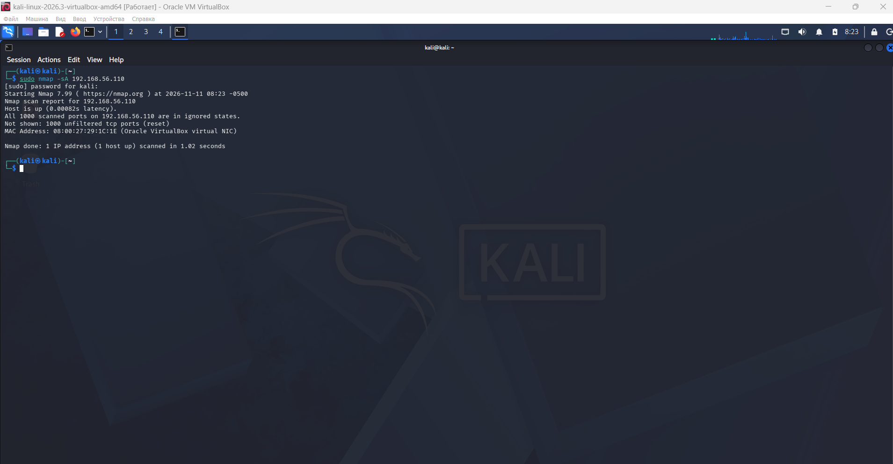
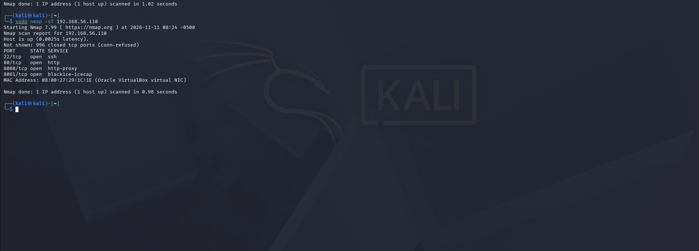
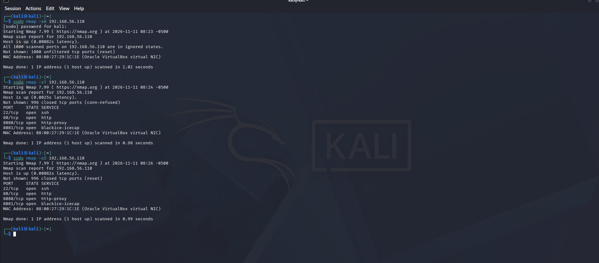
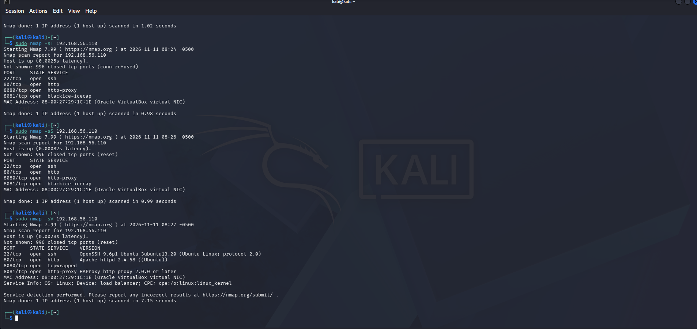
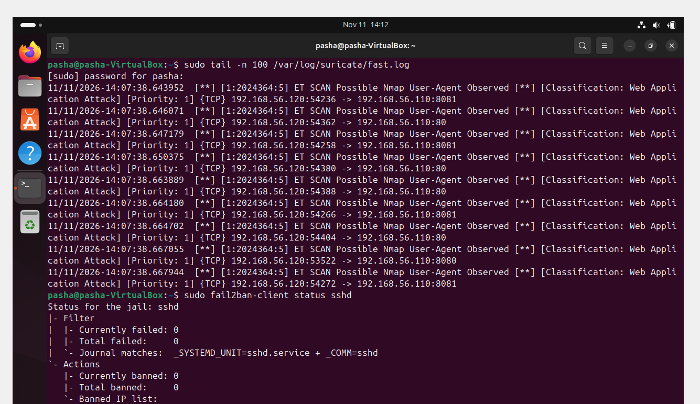
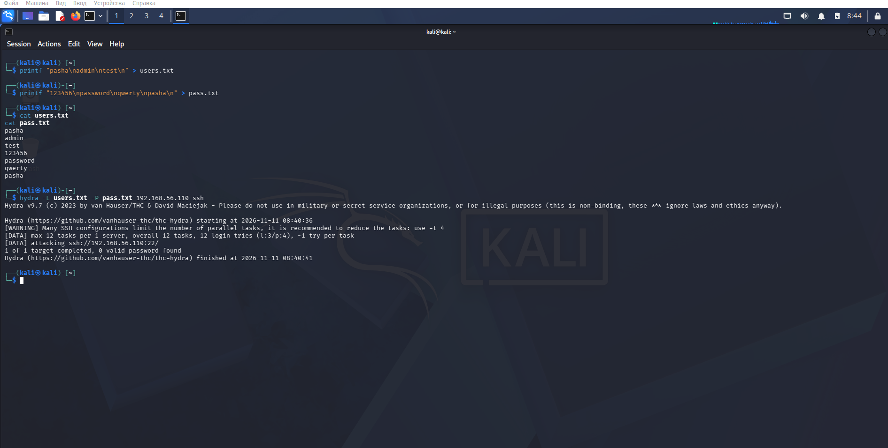
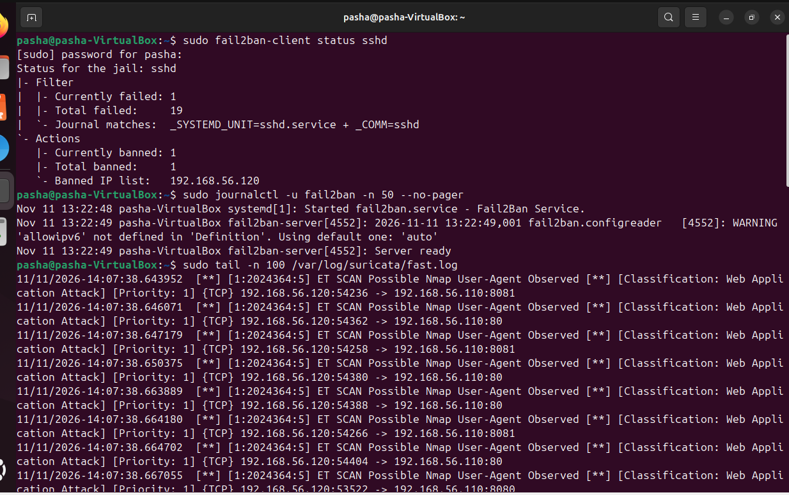
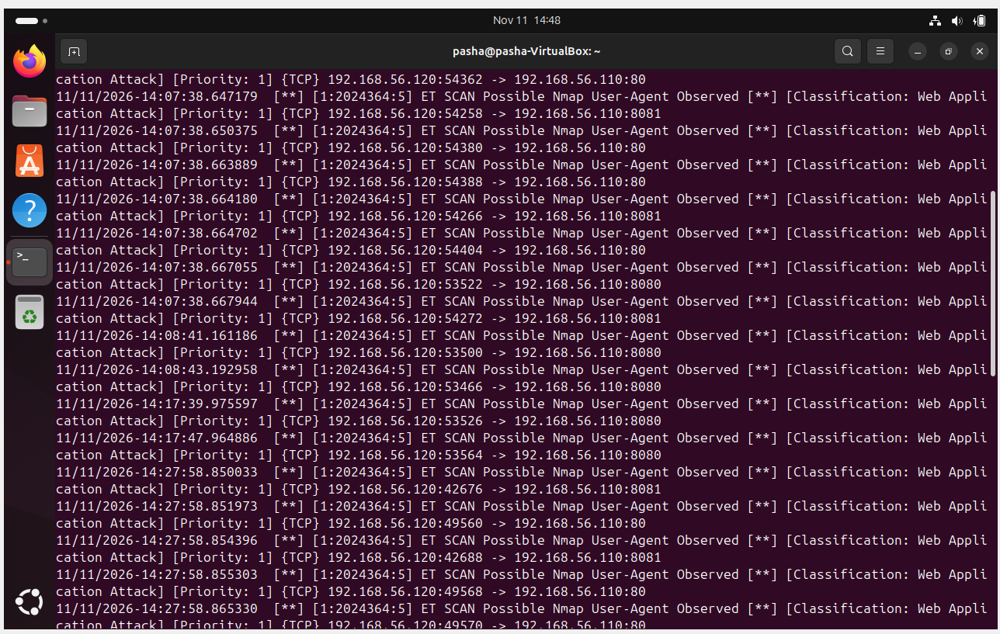
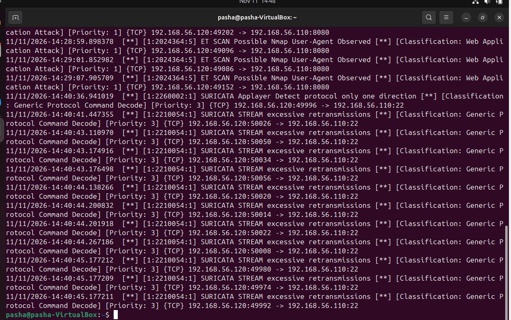

# Домашнее задание к занятию «Защита сети»

**Выполнил: Павел Чернов**

## Подготовка стенда

Для выполнения домашнего задания использовались две виртуальные машины в Oracle VirtualBox.

Защищаемая система:

- Ubuntu 24.04;
- IP-адрес: `192.168.56.110`;
- установлены Suricata, Fail2Ban и OpenSSH.

Система для тестирования:

- Kali Linux;
- IP-адрес: `192.168.56.120`;
- использовались Nmap и Hydra.

Обе виртуальные машины находятся в одной Host-only сети VirtualBox.

---

## Задание 1

Провёл разведку защищаемой системы с помощью нескольких режимов Nmap.

### ACK scan

Команда:

```bash
sudo nmap -sA 192.168.56.110
```

Все 1000 проверенных TCP-портов были определены как `unfiltered`.



### TCP Connect scan

Команда:

```bash
sudo nmap -sT 192.168.56.110
```

Были обнаружены открытые порты:

- `22/tcp` — SSH;
- `80/tcp` — HTTP;
- `8080/tcp` — HTTP Proxy;
- `8081/tcp` — HTTP Proxy.



### SYN scan

Команда:

```bash
sudo nmap -sS 192.168.56.110
```

Также были обнаружены открытые порты `22`, `80`, `8080` и `8081`.



### Определение версий сервисов

Команда:

```bash
sudo nmap -sV 192.168.56.110
```

Nmap определил:

- `22/tcp` — OpenSSH 9.6p1;
- `80/tcp` — Apache httpd 2.4.58;
- `8080/tcp` — tcpwrapped;
- `8081/tcp` — HAProxy HTTP proxy.



### Реакция Suricata и Fail2Ban

После сканирования был просмотрен лог Suricata:

```bash
sudo tail -n 100 /var/log/suricata/fast.log
```

Suricata зафиксировала события:

```text
ET SCAN Possible Nmap User-Agent Observed
```

В логах видно обращения с Kali `192.168.56.120` к защищаемой Ubuntu `192.168.56.110`.

Также был проверен Fail2Ban:

```bash
sudo fail2ban-client status sshd
```

После обычного сканирования Nmap блокировок не было:

```text
Currently banned: 0
Total banned: 0
```



Suricata обнаружила сканирование Nmap и записала события в лог. Fail2Ban не выполнил блокировку, так как обычное сканирование портов не является неудачной авторизацией SSH.

---

## Задание 2

Для проверки защиты SSH использовал Hydra.

Создал файлы с именами пользователей и паролями:

```bash
printf "pasha\nadmin\ntest\n" > users.txt
printf "123456\npassword\nqwerty\npasha\n" > pass.txt
```

Запустил подбор пароля:

```bash
hydra -L users.txt -P pass.txt 192.168.56.110 ssh
```

Hydra выполнила 12 попыток авторизации.

Подходящий пароль найден не был:

```text
12 login tries
0 valid password found
```



### Реакция Fail2Ban

Проверил статус:

```bash
sudo fail2ban-client status sshd
```

После неудачных попыток авторизации Fail2Ban заблокировал IP-адрес Kali:

```text
Total failed: 19
Currently banned: 1
Total banned: 1
Banned IP list: 192.168.56.120
```



### Реакция Suricata

В логах Suricata были зарегистрированы события сетевой активности.



При атаке на SSH были зафиксированы соединения с `192.168.56.120` на `192.168.56.110:22`.

В логах присутствовали события:

```text
SURICATA Applayer Detect protocol only one direction
SURICATA STREAM excessive retransmissions
```



---

## Вывод

В ходе работы Suricata обнаружила сетевое сканирование и зарегистрировала активность при атаке на SSH.

Fail2Ban не реагировал на обычное сканирование портов, но после серии неудачных попыток входа по SSH автоматически заблокировал IP-адрес Kali `192.168.56.120`.